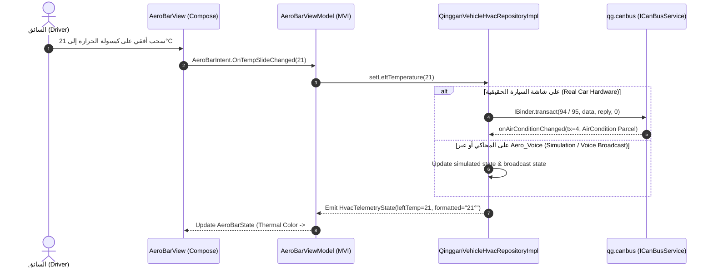
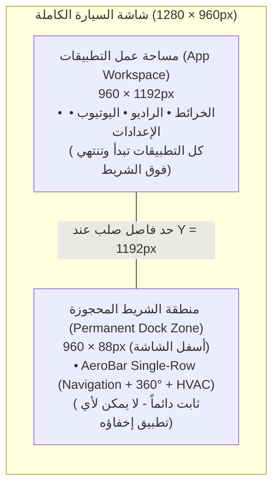

# AeroBar — نظام التحكم الموحد والتنقل لشاشة Dongfeng Shine (960×1280)

تطبيق **`AeroBar`** هو البديل الهندسي الكامل لشريط النظام الأصلي (`SystemUI Navigation & HVAC Bar`) في سيارة **Dongfeng Shine**. تم بناء المشروع من الصفر باستخدام **Kotlin** و **Jetpack Compose** وفق معمارية **Clean Architecture** ومبادئ **SOLID** ونمط **MVI (Model-View-Intent)**، مع اتصال مباشر (Zero-Latency) بخدمات الـ **CAN-Bus** والـ **Binder** الخاصة بالسيارة، وأيقونات فيكتور مرسومة برمجياً بالكامل (**100% Pure Compose `ImageVector`**).

---

## 1. نظرة عامة على التصميم والمميزات (Key Features)

1. **شريط موحد في صف واحد فقط (`Single-Row 960×88px`)**:
   - تقليص ارتفاع الشريط من صفين (`176px`) إلى صف واحد رشيق بارتفاع **`88px`** فقط، مما يوفر **`88px` إضافية** لكل التطبيقات والخرائط على الشاشة (`960×1192px` مساحة صافية).
   - خلفية **Pure OLED Black (`#000000`)** بدون أي إطارات خارجية (`Zero Outlines / Zero Borders`).
   - يضم **13 وظيفة كاملة** في صف واحد متناسق (أسلوب **Design #1 Icons** + **Design #5 Radial Glow & Bottom Indicator Bar**):
     - **مجموعة التنقل (يسار)**: رجوع (`Back`)، الرئيسية (`Home`)، التطبيقات المفتوحة (`Recents` — ضغطة واحدة تفتح القائمة، وضغطتين سريعتين `Double-Tap` تبدّل فوراً بين آخر تطبيقين `Alt+Tab`)، وجميع التطبيقات (`All Apps`).
     - **زر كاميرات الرؤية المحيطية (`360° AVM Camera`)**: يفتح ويغلق نظام الكاميرات المحيطية (`ISystemPolicy.showAVM`) بضغطة واحدة.
     - **مجموعة التكييف الوسطى (`HVAC Core`)**:
       - زر **`AC`** نصي واضح لتشغيل/إيقاف كمبريسور التكييف.
       - زر **`AUTO`** نصي لتفعيل/إلغاء الوضع الأوتوماتيكي.
       - **كبسولة الحرارة (`− 21° +`)**: تدعم الضغط أو **السحب الأفقي السريع (`Horizontal Slide Gesture`)** لتغيير الحرارة، مع **تلوين حراري ذكي (`Dynamic Thermal Color`)**: أزرق ثلجي (`#00D2FF`) للبرودة (`16°..21°`)، أبيض نقي (`#FFFFFF`) للاعتدال (`22°..25°`)، وبرتقالي دافئ (`#FF9F43`) للتسخين (`26°..32°`).
       - **كبسولة سرعة المروحة (`− [Fan] 3 +`)**: تدعم الضغط أو **السحب الأفقي (`1..8`)** مع أيقونة مروحة انسيابية ذات 4 ريش.
     - **مجموعة السيارة (يمين)**:
       - **تطبيق التحكم الكامل بالمقاعد والتكييف (`Climate & Seats App`)**: يفتح/يغلق تطبيق `com.qinggan.app.vehicle` مباشرة على تبويب التكييف والكراسي (`TAB_ID = 2`).
       - **إزالة الشبورة الأمامية (`Front Defrost`)**: يضيء باللون البرتقالي الحراري (`#FF9F43`) عند التفعيل.
       - **تدوير الهواء الداخلي (`Cabin Air Recirculation`)**: مجسم سيارة جانبي مع سهم دوران داخلي.
       - **إطفاء الشاشة (`Screen Standby`)**: رمز الهلال (`IPowerManagerService.enterStandby`).

2. **ثبات مطلق وحجز مساحة الشاشة (`3-Layer Permanent Dock & 88px Workspace Reservation`)**:
   - لا يمكن لأي تطبيق أو لعبة أو مشغل فيديو إخفاء الشريط أو فتح `Immersive Fullscreen` فوقه، لأن الشريط يمثل وحدة التحكم الأساسية في تكييف السيارة.
   - يقوم النظام برفع جميع التطبيقات المفتوحة للأعلى بمقدار **`88px`** بحيث تنتهي مساحة عمل التطبيقات عند `1192px` ولا يفتح أي تطبيق تحت الشريط أبداً.

3. **نافذة التطبيقات المفتوحة (`Recent Apps Overlay`) وحماية البلوتوث الذكية**:
   - نافذة عائمة سوداء بالكامل (`860dp` عرض، بدون أي `Outlines`) تعرض **5 بطاقات تطبيقات في نفس اللحظة** (`150×215dp`).
   - شريط حي لاستهلاك الذاكرة العشوائية (`System RAM Used / Total GB + %`) مع شارة استهلاك `MB` لكل تطبيق.
   - **حماية البلوتوث الذكية (`Smart Bluetooth Protection`)**: عند إغلاق تطبيق البلوتوث (`com.qinggan.bluetoothphone`)، يتم إغلاق نافذة الواجهة فقط (`removeTask`) دون إيقاف خدمة الصوت في الخلفية (`forceStopPackage` ممنوع للبلوتوث)، بينما يتم إغلاق الراديو والموسيقى وباقي التطبيقات بالكامل لتفريغ الـ `RAM`.

4. **نافذة جميع التطبيقات (`All Apps Drawer`)**:
   - شبكة خماسية الأعمدة (`5 Columns LazyVerticalGrid`) بتصميم أسود نقي بدون حدود.
   - تعرض **الـ 8 تطبيقات الأساسية للسيارة** (البلوتوث، الراديو، الموسيقى، الفيديو، التكييف والمقاعد، الإعدادات، CarPlay/CarLife، كاميرا التسجيل DVR) جنباً إلى جنب مع تطبيقات المستخدم، مع فلترة وإخفاء أكثر من 94 حزمة نظام داخلية صينية لمنع الفوضى.

---

## 2. الرسم التخطيطي للمعمارية الشاملة (System Architecture Diagram)

```mermaid
flowchart TB
    subgraph UI["Presentation Layer (Jetpack Compose + MVI)"]
        direction TB
        Service["AeroBarOverlayService\n(Permanent 88dp System Dock + Overlay Host)"]
        BarView["AeroBarView.kt\n(Single-Row 960x88px • 13 Controls • Swipe Steppers)"]
        RecentsView["RecentAppsView.kt\n(860dp Pure Black • 5 Visible Cards • RAM Bar)"]
        DrawerView["AppDrawerView.kt\n(860dp Pure Black • 5-Column Grid)"]
        Icons["AeroIcons.kt\n(12 Pure Compose ImageVector Icons)"]

        BarVM["AeroBarViewModel\n(StateFlow<AeroBarState>)"]
        RecentsVM["RecentAppsViewModel\n(StateFlow<RecentAppsState>)"]
        DrawerVM["AppDrawerViewModel\n(StateFlow<AppDrawerState>)"]

        Service --> BarView
        Service --> RecentsView
        Service --> DrawerView
        BarView --> Icons
        BarView <-->|"Intent / State"| BarVM
        RecentsView <-->|"Intent / State"| RecentsVM
        DrawerView <-->|"Intent / State"| DrawerVM
    end

    subgraph Domain["Domain Layer (Pure Kotlin • SOLID Interfaces & Models)"]
        direction LR
        HvacRepo["VehicleHvacRepository\n(Interface)"]
        AppRepo["AppRepository\n(Interface)"]
        RecentRepo["RecentAppsRepository\n(Interface)"]
        Models["Domain Models\n• HvacTelemetryState\n• AppItem\n• RecentTaskItem"]
    end

    subgraph Data["Data & Hardware Layer (Binder IPC + System Services)"]
        direction TB
        HvacImpl["QingganVehicleHvacRepositoryImpl\n(Binder IPC + Broadcast Bridge + Emulator Sim)"]
        AppImpl["AppRepositoryImpl\n(8 Essential Car Apps + User Apps Filter)"]
        RecentImpl["RecentAppsRepositoryImpl\n(Multi-Tier Task Killer + Smart BT Protection)"]
        AirCondParcel["com.qinggan.canbus.AirCondition\n(61-Field Binary Parcelable)"]
    end

    subgraph Hardware["Dongfeng Shine Hardware & OS Services (Android 8.1)"]
        direction LR
        CanBus["qg.canbus\n(ICanBusService)"]
        VehicleSvc["vehicle.service\n(IVehicleService)"]
        PowerSvc["qg.power_manager\n(IPowerManagerService)"]
        PolicySvc["SystemPolicyService\n(ISystemPolicy • 360° AVM)"]
        AMS["ActivityManagerService\n& WindowManagerService"]
    end

    BarVM --> HvacRepo
    BarVM --> AppRepo
    BarVM --> RecentRepo
    RecentsVM --> RecentRepo
    DrawerVM --> AppRepo

    HvacRepo <|.. HvacImpl
    AppRepo <|.. AppImpl
    RecentRepo <|.. RecentImpl
    HvacImpl --> AirCondParcel

    HvacImpl <==>|"IBinder.transact()"| CanBus
    HvacImpl <==>|"IBinder.transact()"| VehicleSvc
    HvacImpl <==>|"IBinder.transact()"| PowerSvc
    HvacImpl <==>|"IBinder.transact()"| PolicySvc
    RecentImpl <==>|"removeTask / forceStop"| AMS
    AppImpl <==>|"PackageManager"| AMS
```

---

## 3. دورة حياة البيانات والتحكم في التكييف (MVI & CAN-Bus Sequence Diagram)

يوضح المخطط التالي كيف تنتقل ضغطة المستخدم أو حركة السحب (`Swipe Gesture`) على كبسولة الحرارة من واجهة Compose إلى الـ `CAN-Bus` الخاص بالسيارة ثم تعود الحالة الحقيقية (`Callback Transaction 4`) لتحديث الواجهة والتلوين الحراري تلقائياً:



---

## 4. معمارية ثبات الشريط وحجز مساحة الشاشة (`88px` Workspace Reservation)

لضمان عدم اختفاء الشريط مطلقاً وعدم تغطيته لأي تطبيق، يطبق `AeroBar` استراتيجية من 3 طبقات متكاملة:



1. **الطبقة الأولى (منع الـ Immersive Fullscreen)**:
   - إزالة أعلام `SYSTEM_UI_FLAG_HIDE_NAVIGATION` و `SYSTEM_UI_FLAG_IMMERSIVE_STICKY` من نافذة الشريط، وتطبيق السياسة العامة `settings put global policy_control immersive.off=*` لمنع أي تطبيق خارجي من إخفاء الشريط.
2. **الطبقة الثانية (رفع التطبيقات للأعلى بمقدار `88px`)**:
   - حجز الـ `88px` السفلية عبر `WindowManager` (`TYPE_NAVIGATION_BAR_PANEL` / `wm overscan 0,0,0,88`) بحيث تنتهي نوافذ جميع التطبيقات ولوحة المفاتيح عند الإحداثي `Y = 1192px` تماماً فوق الشريط.
3. **الطبقة الثالثة (حماية عملية النظام `Persistent Service`)**:
   - تعريف التطبيق بـ `android:persistent="true"` و `START_STICKY` و `foregroundServiceType="specialUse"` ليبقى نشطاً طوال فترة تشغيل السيارة بدون توقف.

---

## 5. جدول بروتوكول الاتصال بعتاد السيارة (Qinggan Binder IPC Reference)

تم استخراج أكواد المعاملات (`Transaction Codes`) بدقة من ملفات `classes.dex` الخاصة بنظام `Qinggan/Pateo SystemUI` لضمان التوافق الثنائي الكامل (`100% Binary Compatibility`) بدون الحاجة لأي مكتبات خارجية مغلقة:

| الخدمة (Service Name) | الواجهة (Interface Descriptor) | العملية (Method) | كود المعاملة (Tx Code) | الوظيفة في `AeroBar` |
| :--- | :--- | :--- | :---: | :--- |
| **`qg.canbus`** | `com.qinggan.canbus.ICanBusService` | `addCallback` | **`27`** | تسجيل مستمع التكييف والـ ACC الحي |
| **`qg.canbus`** | `com.qinggan.canbus.ICanBusService` | `getAirCondition` | **`29`** | قراءة حالة التكييف الحالية (`AirCondition` Parcel) |
| **`qg.canbus`** | `com.qinggan.canbus.ICanBusService` | `getAccStatus` | **`63`** | قراءة حالة مفتاح السيارة (`ACC`) |
| **`qg.canbus`** | `com.qinggan.canbus.ICanBusService` | `openAirConditionSwitch` / `close` | **`88` / `89`** | تشغيل / إيقاف زر **`AC`** |
| **`qg.canbus`** | `com.qinggan.canbus.ICanBusService` | `openAirAutoMode` / `close` | **`90` / `91`** | تشغيل / إيقاء زر **`AUTO`** |
| **`qg.canbus`** | `com.qinggan.canbus.ICanBusService` | `openAirFrontWindowDefogger` / `close` | **`92` / `93`** | تشغيل / إيقاف إزالة الشبورة الأمامية |
| **`qg.canbus`** | `com.qinggan.canbus.ICanBusService` | `setAirLeftTemperatureUp` / `Down` | **`94` / `95`** | رفع / خفض درجة الحرارة (`16°C .. 32°C`) |
| **`qg.canbus`** | `com.qinggan.canbus.ICanBusService` | `setAirWindSpeedUp` / `Down` | **`96` / `97`** | رفع / خفض سرعة المروحة (`1 .. 8`) |
| **`qg.canbus`** | `com.qinggan.canbus.ICanBusService` | `switchAirCirculationMode` | **`98`** | تبديل تدوير الهواء الداخلي / الخارجي |
| **`vehicle.service`** | `com.qinggan.vehicle.IVehicleService` | `registerCallback` / `closeVehicle` | **`1` / `20`** | مراقبة وإغلاق تطبيق التحكم الكامل بالمقاعد والتكييف |
| **`qg.power_manager`** | `com.qinggan.system.IPowerManagerService` | `enterStandby` / `exitScreenOff` | **`19` / `6`** | إطفاء الشاشة (وضع الهلال) أو إيقاظها |
| **`SystemPolicyService`** | `com.qinggan.system.ISystemPolicy` | `showAVM` / `getAVMState` | **`20` / `29`** | فتح / إغلاق كاميرات **`360° AVM`** |

---

## 6. هيكل الملفات والمجلدات (Project Directory Structure)

```text
Aero_Bar/
├── app/src/main/
│   ├── AndroidManifest.xml                  # إعدادات الصلاحيات والخدمة الدائمة (persistent="true")
│   └── java/
│       ├── com/qinggan/canbus/
│       │   └── AirCondition.kt              # الكلاس المتوافق ثنائياً مع CAN-Bus السيارة (61 حقل Parcelable)
│       └── com/aero/bar/
│           ├── AeroBarApplication.kt        # نقطة بداية Hilt Dependency Injection
│           ├── di/
│           │   └── AppModule.kt             # ربط الواجهات (Repositories) بمثيلاتها التنفيذية (SingletonComponent)
│           ├── domain/                      # طبقة الـ Domain المستقلة (Pure Kotlin)
│           │   ├── model/
│           │   │   ├── HvacTelemetryState.kt # نموذج حالة التكييف والكاميرا 360 والغيار الخلفي
│           │   │   ├── AppItem.kt           # نموذج بيانات التطبيق في درج التطبيقات
│           │   │   └── RecentTaskItem.kt    # نموذج التطبيق المفتوح واستهلاك الـ RAM
│           │   └── repository/
│           │       ├── VehicleHvacRepository.kt
│           │       ├── AppRepository.kt
│           │       └── RecentAppsRepository.kt
│           ├── data/                        # طبقة البيانات والعتاد (Data & Hardware Layer)
│           │   ├── local/
│           │   │   └── AeroBarPreferences.kt
│           │   └── repository/
│           │       ├── QingganVehicleHvacRepositoryImpl.kt # عميل الـ Binder المباشر + محاكي التكييف الذكي
│           │       ├── AppRepositoryImpl.kt                # فلترة الـ 8 تطبيقات الأساسية + تطبيقات المستخدم
│           │       └── RecentAppsRepositoryImpl.kt         # إدارة الـ RAM + التبديل السريع + حماية البلوتوث
│           ├── service/
│           │   ├── AeroBarOverlayService.kt # خدمة النافذة الدائمة وإدارة حجز مساحة الشاشة والـ Animations
│           │   ├── AeroAccessibilityService.kt # محاكاة أزرار النظام (Back / Home / Recents)
│           │   └── OverlayServiceLifecycleOwner.kt
│           └── ui/                          # طبقة الواجهة الرسومية (Jetpack Compose + MVI)
│               ├── icons/
│               │   └── AeroIcons.kt         # الـ 12 أيقونة المرسومة برمجياً بالكامل (Design #1 Vectors)
│               ├── bar/
│               │   ├── AeroBarContract.kt   # حالة وأحداث الشريط (State & Intents)
│               │   ├── AeroBarViewModel.kt  # منطق التحكم في الـ 13 وظيفة والسحب الأفقي
│               │   └── AeroBarView.kt       # واجهة الشريط الموحد (960x88px • Pure Black • Design #5 Glow)
│               ├── recents/
│               │   ├── RecentAppsContract.kt
│               │   ├── RecentAppsViewModel.kt
│               │   └── RecentAppsView.kt    # نافذة التطبيقات المفتوحة (5 بطاقات • شريط RAM • بدون حدود)
│               └── drawer/
│                   ├── AppDrawerContract.kt
│                   ├── AppDrawerViewModel.kt
│                   └── AppDrawerView.kt     # نافذة جميع التطبيقات (شبكة 5 أعمدة • بدون حدود)
```

---

## 7. طريقة البناء والتثبيت (Build & Deployment)

### 1. بناء ملف الـ APK:
```powershell
.\gradlew.bat assembleDongfeng_shineDebug
```
ينتج ملف الـ APK في المسار:
`app/build/outputs/apk/dongfeng_shine/debug/app-dongfeng_shine-debug.apk`

### 2. التثبيت والتشغيل المباشر عبر ADB:
```powershell
adb install -r app/build/outputs/apk/dongfeng_shine/debug/app-dongfeng_shine-debug.apk
adb shell appops set com.aero.bar SYSTEM_ALERT_WINDOW allow
adb shell appops set com.aero.bar GET_USAGE_STATS allow
adb shell am start-foreground-service -n com.aero.bar/.service.AeroBarOverlayService
```

### 3. اختبار أوامر التكييف الصوتية أو البرمجية (`Aero_Voice Bridge`):
يدعم `AeroBar` استقبال أوامر التكييف المباشرة من المساعد الصوتي `Aero_Voice` عبر Broadcast:
```powershell
# مثال: ضبط الحرارة على 20 درجة مئوية
adb shell am broadcast -a com.dongfeng.intent.action.HVAC_CONTROL --es cmd set_temp --ei value 20

# مثال: ضبط سرعة المروحة على المستوى 5
adb shell am broadcast -a com.dongfeng.intent.action.HVAC_CONTROL --es cmd set_fan --ei value 5
```
